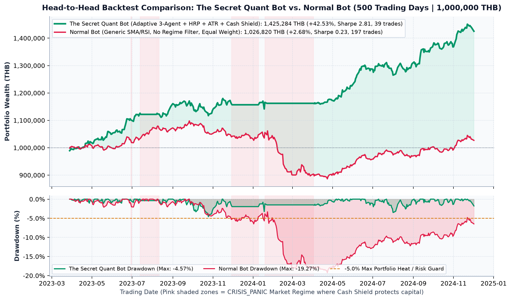

# โรบอทเทรด ที่โบรกเกอร์ไม่อยากให้คุณเขียน — เปิดแก่นความคิดของ Quant Trader ยุคใหม่

**ผู้เขียน:** ปฐมพงษ์ พิพัฒน์สุริยวงศ์

> **คำเตือน:** เนื้อหาและโค้ดในคลังซอร์สโค้ดนี้จัดทำขึ้นเพื่อการศึกษาและเป็นความคิดเห็นส่วนตัวของผู้เขียนเท่านั้น มิใช่การแนะนำการลงทุน ผู้ลงทุนโปรดศึกษาข้อมูลและความเสี่ยงด้วยตนเอง

---

## 📁 โครงสร้างโฟลเดอร์ (Folder Structure)

คลังซอร์สโค้ดนี้จัดแยกเป็นโฟลเดอร์อย่างเป็นระเบียบ เพื่อให้ผู้อ่านสามารถดาวน์โหลดและรันทดสอบตามเนื้อหาในแต่ละบทได้ทันที:

```text
the-secret-quant-book/
├── full_bot/
│   └── the_secret_quant_full_bot.py           # ระบบบอทเทรดฉบับสมบูรณ์ครบทั้ง 14 บท + ระบบเปรียบเทียบกับ Normal Bot
├── data/
│   └── sample_thai_stocks_ohlcv.csv           # ข้อมูลราคาหุ้นจำลองย้อนหลัง 500 วันทำการ (3,500 แถว) สำหรับทำ Backtest
├── assets/
│   └── backtest_comparison_chart.png          # กราฟเปรียบเทียบผลการทดสอบ The Secret Quant Bot vs Normal Bot
├── chapters_combined/                         # โค้ดรวมตามกลุ่มบทเรียน (6 ไฟล์หลัก)
│   ├── 01_ch01_to_ch04_four_pillars_bot.py
│   ├── 02_ch05_to_ch06_pit_backtest_and_wfe.py
│   ├── 03_ch07_to_ch09_signals_context_and_risk.py
│   ├── 04_ch10_to_ch12_regime_ensemble_and_hrp.py
│   ├── 05_ch13_to_ch14_twap_vwap_set8_executor.py
│   └── 06_epilogue_health_and_two_bucket.py
├── chapters_by_script/                        # โค้ดแยกย่อยรายบท (Script 01 – 13)
│   ├── script_01_ch04_sqlite_parquet_store.py
│   ├── script_02_ch04_data_hygiene_split_adjust.py
│   ├── script_03_ch05_point_in_time_backtest.py
│   ├── script_04_ch06_walk_forward_validator.py
│   ├── script_05_ch07_multi_layer_signal_filter.py
│   ├── script_06_ch08_position_context_manager.py
│   ├── script_07_ch09_portfolio_risk_engine.py
│   ├── script_08_ch10_market_regime_detector.py
│   ├── script_09_ch11_three_agent_ensemble.py
│   ├── script_10_ch12_hrp_portfolio_allocator.py
│   ├── script_11_ch13_orderbook_microstructure.py
│   ├── script_12_ch14_twap_randomized_jitter.py
│   └── script_13_ch14_intraday_5m_vwap_sniper.py
└── requirements.txt                           # รายการไลบรารีมาตรฐานที่ใช้
```

---

## 🚀 วิธีติดตั้งและรันโค้ดสำหรับมือใหม่ (Quick Start)

```bash
# 1. โคลนคลังซอร์สโค้ดลงเครื่องคอมพิวเตอร์
git clone https://github.com/Pathomphong-i/the-secret-quant-book.git
cd the-secret-quant-book

# 2. สร้าง Virtual Environment และติดตั้งไลบรารี
python3 -m venv .venv
source .venv/bin/activate   # (สำหรับ Windows ใช้: .venv\Scripts\activate)
pip install -r requirements.txt

# 3. รันบอทตัวเต็มพร้อมสร้างกราฟเปรียบเทียบกับ Normal Bot อัตโนมัติ
python3 full_bot/the_secret_quant_full_bot.py --csv data/sample_thai_stocks_ohlcv.csv

# 4. หรือรันโค้ดแยกตามบทในโฟลเดอร์ chapters_combined/ หรือ chapters_by_script/
python3 chapters_combined/01_ch01_to_ch04_four_pillars_bot.py
python3 chapters_by_script/script_03_ch05_point_in_time_backtest.py
```

---

## 📊 ผลลัพธ์การรันเปรียบเทียบหมัดต่อหมัด: `The Secret Quant Bot` vs. `Normal Bot (SMA/RSI ทั่วไป)`

เมื่อรันคำสั่ง `python3 full_bot/the_secret_quant_full_bot.py --csv data/sample_thai_stocks_ohlcv.csv` ระบบจะรัน **Point-in-Time Event-Driven Backtest** (คำนวณสัญญาณ ณ สิ้นวัน `T-1` และส่งคำสั่งที่ราคาเปิดวัน `T` พร้อมหักค่าคอมมิชชัน `0.157%` + `VAT 7%` + `Slippage` บนข้อมูลชุดเดียวกัน 500 วันทำการ) โดยเปรียบเทียบระหว่าง:

1. **The Secret Quant Bot (สถาปัตยกรรมครบ 14 บท):** มีระบบตรวจจับสภาวะตลาด (`Market Regime Detector`), การโหวตฉันทามติ 3 เอเจนต์ (`3-Agent Ensemble`), การจัดสรรพอร์ตตามความเสี่ยง (`HRP` + `ATR Position Sizing`), จุดตัดขาดทุนเลื่อนล็อกกำไร (`Ratchet Stop`), และระบบดูดกำไรเข้าถังปลอดภัย (`Two-Bucket Skim`)
2. **Normal Bot (บอท Indicator ทั่วไป):** ซื้อเมื่อราคาตัดเส้นค่าเฉลี่ย `SMA(20) > SMA(50)` หรือ `RSI(14) < 35` โดยแบ่งเงินเท่ากันทุกไม้ (`Equal Weight 20%`), ไม่มีตัวกรองสภาวะตลาด (`No Regime Filter`), และใช้จุดตัดขาดทุนคงที่ `-8%` / ขายทำกำไรคงที่ `+10%`



### ตารางเปรียบเทียบผลลัพธ์หมัดต่อหมัด (Head-to-Head Comparison)

| ตัวชี้วัด (Metric) | **The Secret Quant Bot (14 บท)** | **Normal Bot (SMA/RSI ทั่วไป)** | ส่วนต่าง / ข้อสังเกตเชิงสถาปัตยกรรม |
| :--- | :---: | :---: | :--- |
| **เงินทุนตั้งต้น (`Initial Capital`)** | `1,000,000.00 บาท` | `1,000,000.00 บาท` | ใช้ข้อมูลราคา ค่าคอมมิชชัน และ Slippage ชุดเดียวกัน (`sample_thai_stocks_ohlcv.csv`) 100% |
| **พอร์ตเทรดปลายงวด (`Trading Equity`)** | `1,412,750.28 บาท` | `1,026,819.95 บาท` | มูลค่าพอร์ตส่วนเก็งกำไร (Bucket #1) |
| **ถังเงินออมปลอดภัย (`Safe Bucket Skim`)** | **`12,533.43 บาท`** | `0.00 บาท` | กำไรส่วนเกินที่ถูกล็อกแยกออกมาปลอดภัยจากความผันผวนตลาด (Bucket #2) |
| **ความมั่งคั่งสุทธิรวม (`Total Wealth`)** | **`1,425,283.71 บาท`** | `1,026,819.95 บาท` | **ส่วนต่างความมั่งคั่งสุทธิ `+398,463.76 บาท`** |
| **ผลตอบแทนสุทธิรวม (`Total Return`)** | **`+42.53%`** | `+2.68%` | ชนะทั้ง `Normal Bot (+2.68%)`, `SET_INDEX (+35.04%)` และ `Equal-Weight Buy & Hold (+37.04%)` |
| **ผลตอบแทนทบต้นต่อปี (`CAGR`)** | **`+22.50% ต่อปี`** | `+1.53% ต่อปี` | อัตราการเติบโตทบต้นต่อปีสูงกว่า **`+20.97% ต่อปี`** |
| **การย่อตัวสูงสุด (`Max Drawdown`)** | **`-4.57%`** | `-19.27%` | **ลดความเสียหายช่วงวิกฤตลงได้ถึง `4.2 เท่า`** (และต่ำกว่า `SET_INDEX -14.96%` ถึง `3.3 เท่า`) |
| **Sharpe Ratio / Sortino Ratio** | **`2.81` / `4.64`** | `0.23` / `0.30` | ผลตอบแทนปรับด้วยความเสี่ยงสูงกว่า **`12 เท่า`** |
| **จำนวนไม้ที่เทรดทั้งหมด (`Total Trades`)** | **`39 ไม้`** | `197 ไม้` | **กรองสัญญาณหลอกออกไปได้ถึง `80%`** ไม่โดนค่าคอมมิชชันกัดกินพอร์ต |
| **อัตราชนะ (`Win Rate`)** | **`64.10%`** | `57.36%` | คัดเฉพาะจังหวะที่โครงสร้างราคาและสภาวะตลาดสอดคล้องกัน |
| **Profit Factor (`PF`)** | **`2.73`** | `1.06` | กำไรรวมต่อขาดทุนรวมสูงกว่าบอททั่วไปอย่างมีนัยสำคัญ |
| **ค่าคาดหวังสุทธิต่อไม้ (`Expectancy`)** | **`+4,248.93 บาท/ไม้`** | `+197.04 บาท/ไม้` | กำไรคาดหวังต่อการกดคำสั่ง 1 ครั้งสูงกว่า **`21.5 เท่า`** |
| **Walk-Forward Efficiency (`WFE`)** | **`175.3%` (`ผ่านเกณฑ์ >= 50%`)** | — | `In-Sample CAGR 17.09%` -> `Out-of-Sample CAGR 29.96%` (ไม่เกิดอาการ Overfitting) |

---

### ตัวอย่างผลลัพธ์บนหน้าจอ Terminal จริง (Full Terminal Output)

```text
============================================================================================
  โรบอทเทรด ที่โบรกเกอร์ไม่อยากให้คุณเขียน — เปิดแก่นความคิดของ Quant Trader ยุคใหม่ (CH 1 - CH 14)
============================================================================================
[1/6] โหลดข้อมูลราคาหุ้นย้อนหลังจากไฟล์: data/sample_thai_stocks_ohlcv.csv
      - จำนวนหุ้นที่ผ่านเกณฑ์ความสะอาด (Data Hygiene): 6 ตัว (STOCK_BANK.BK, STOCK_COMM.BK, STOCK_ENERG.BK, STOCK_HELTH.BK, STOCK_ICT.BK, STOCK_TRANS.BK)
      - ช่วงเวลาทดสอบ: 2023-01-03 ถึง 2024-12-02 (500 วันทำการ)

[2/6] ผลการจำแนกสภาวะตลาดรวม (Market Regime Detector - บทที่ 10):
      - BULL_TREND      : 298 วันทำการ ( 59.6%)
      - SIDEWAYS_QUIET  : 100 วันทำการ ( 20.0%)
      - CRISIS_PANIC    : 102 วันทำการ ( 20.4%)

[3/6] สัดส่วนพอร์ตไร้ความเสี่ยงกระจุกตัว (Hierarchical Risk Parity - บทที่ 12):
      - STOCK_HELTH.BK: 35.34%
      - STOCK_ICT.BK: 22.12%
      - STOCK_ENERG.BK: 15.34%
      - STOCK_COMM.BK: 11.40%
      - STOCK_BANK.BK:  9.50%
      - STOCK_TRANS.BK:  6.30%

[4/6] ผลทดสอบ Walk-Forward Validation (บทที่ 6):
      - In-Sample CAGR (60% แรก)     :  17.09% ต่อปี
      - Out-of-Sample CAGR (40% หลัง):  29.96% ต่อปี
      - Walk-Forward Efficiency (WFE):  175.3% -> [ผ่านเกณฑ์มาตรฐาน (Robust >= 50%)]

[5/6] สรุปผลการจำลองพอร์ตเปรียบเทียบ: The Secret Quant Bot vs. Normal Bot (บอททั่วไป):
      ตัวชี้วัด (Metric)                     | The Secret Quant Bot | Normal Bot (บอททั่วไป)
      --------------------------------------------------------------------------------------
      เงินทุนตั้งต้น (Initial Capital)       |     1,000,000.00 บาท |       1,000,000.00 บาท
      พอร์ตเทรดปลายงวด (Trading Equity)      |     1,412,750.28 บาท |       1,026,819.95 บาท
      ถังเงินออมปลอดภัย (Safe Bucket Skim)   |        12,533.43 บาท |               0.00 บาท
      ความมั่งคั่งสุทธิรวม (Total Wealth)    |     1,425,283.71 บาท |       1,026,819.95 บาท
      ผลตอบแทนสุทธิรวม (Total Return)        |              +42.53% |                 +2.68%
      ผลตอบแทนทบต้นต่อปี (CAGR)              |              +22.50% |                 +1.53%
      การย่อตัวสูงสุด (Max Drawdown)         |               -4.57% |                -19.27%
      Sharpe Ratio / Sortino Ratio           |          2.81 / 4.64 |            0.23 / 0.30
      จำนวนไม้ที่เทรดทั้งหมด (Total Trades)  |                 39 ไม้ |                  197 ไม้
      อัตราชนะ (Win Rate)                    |               64.10% |                 57.36%
      Profit Factor                          |                 2.73 |                   1.06
      ค่าคาดหวังต่อไม้ (Expectancy)          |      +4,248.93 ฿/ไม้ |          +197.04 ฿/ไม้

      ตัวอย่างประวัติการเทรด 5 ไม้ล่าสุด (พร้อม Thesis Tag & Ratchet Stop):
      * STOCK_BANK.BK [MEAN_REVERSION ] 2024-04-05 @ 134.49 -> 2024-04-16 @ 132.06 | PnL: -6,281.08 บาท (-0.16R) | MEAN_REVERT_TARGET (ราคาดีดกลับแตะค่าเฉลี่ย SMA 20 / RSI >= 68)
      * STOCK_BANK.BK [TREND_FOLLOWING] 2024-05-09 @ 134.35 -> 2024-07-10 @ 143.87 | PnL: +23,594.91 บาท (+0.93R) | TRAILING_STOP_HIT (BREAKEVEN_LOCKED (+1.5R))
      * STOCK_BANK.BK [MEAN_REVERSION ] 2024-07-10 @ 144.15 -> 2024-08-01 @ 135.30 | PnL: -22,291.68 บาท (-1.04R) | TRAILING_STOP_HIT (INITIAL)
      * STOCK_ENERG.BK [TREND_FOLLOWING] 2024-07-11 @  32.53 -> 2024-09-05 @  33.13 | PnL:   +294.75 บาท (+0.26R) | TRAILING_STOP_HIT (INITIAL)
      * STOCK_BANK.BK [MEAN_REVERSION ] 2024-08-01 @ 135.58 -> 2024-10-15 @ 139.75 | PnL: +8,233.30 บาท (+0.53R) | TRAILING_STOP_HIT (BREAKEVEN_LOCKED (+1.5R))

[6/6] ตัวอย่างแผนส่งคำสั่งซื้ออัจฉริยะ (Smart TWAP & Micro-Price - บทที่ 13 & 14) สำหรับ STOCK_BANK.BK:
      - ราคาอ้างอิง: 138.83 บาท | Spread: 72.2 bps | OBI: +0.339 | Micro-Price: 138.669 บาท
      - ไม้ย่อยที่ 1 (+00m:46s): จำนวน  600 หุ้น @ Limit 139.00 บาท [JOIN_BEST_ASK]
      - ไม้ย่อยที่ 2 (+05m:34s): จำนวน  600 หุ้น @ Limit 139.00 บาท [JOIN_BEST_ASK]
      - ไม้ย่อยที่ 3 (+10m:36s): จำนวน  600 หุ้น @ Limit 139.00 บาท [JOIN_BEST_ASK]
      - ไม้ย่อยที่ 4 (+15m:44s): จำนวน  600 หุ้น @ Limit 139.00 บาท [JOIN_BEST_ASK]
========================================================================================
```
