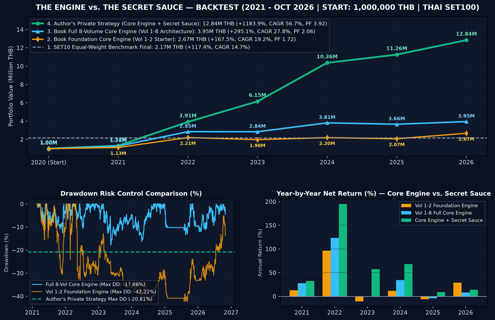

# โรบอทเทรด ที่โบรกเกอร์ไม่อยากให้คุณเขียน — The Secret Quant: 8-Volume Masterclass Series (Official Repository)

คลังซอร์สโค้ดอย่างเป็นทางการ ชุดข้อมูลทดสอบย้อนหลัง (`Backtest Dataset`) และสะพานเชื่อมระบบจริง (**Last-Mile Production Bridges**) ประกอบหนังสือชุด **"โรบอทเทรด ที่โบรกเกอร์ไม่อยากให้คุณเขียน — The Secret Quant: 8-Volume Masterclass Series"** ทั้ง **8 เล่มจบ** โดย **ปฐมพงษ์ พิพัฒน์สุริยวงศ์**

คลังโค้ดนี้ออกแบบเป็นโครงสร้างโฟลเดอร์แยกตามเล่ม (**Volume 1 ถึง Volume 8**) เพื่อให้ผู้อ่านสามารถ:
1. **รันทดสอบแบบออฟไลน์ได้ทันที 100% (Zero-Config Offline Simulation)** โดยไม่ต้องตั้งค่า API Key ใดๆ
2. **สลับไปเชื่อมต่อระบบจริง (Live Production Bridges)** ทั้งการดึงข้อมูลหุ้นไทยและวันปันผล/แตกพาร์จาก **`yfinance`**, การแปลงกระดาน 5 ช่องราคาจาก **`Settrade Open API v2`**, การสกัดสัญญาณข่าวและงบการเงินด้วย **`Google Gemini API (google-genai)`**, และการรันบอทบน Cloud VPS ตลอด 24/7 ด้วย **`Docker & Docker Compose`**

---

## ⚙️ Engine vs. Secret Sauce: ขอบเขตของโค้ดในหนังสือเล่มนี้

> **ทำไมถึงเปิดเผยโครงสร้างระบบ แต่ไม่แจกสูตรพารามิเตอร์สำเร็จรูป?**
>
> หลายคนมักตั้งคำถามว่า *"ถ้าระบบเทรดดีจริง ทำไมถึงเอามาเปิดเผย?"*
>
> ในโลกของการพัฒนาบอทเทรด เราต้องแยก 2 ส่วนนี้ออกจากกันครับ:
> * **The Engine (เครื่องยนต์และโครงสร้าง):** ระบบเชื่อมต่อ API, การจัดการ Data Pipeline, โครงสร้างการทำ Backtest และการควบคุม Order — **ส่วนนี้คือความรู้ทางวิศวกรรมที่แชร์กันได้ และอยู่ในหนังสือเล่มนี้ทั้งหมด**
> * **The Secret Sauce (กลยุทธ์และพารามิเตอร์):** เงื่อนไขการเข้าออกออเดอร์เฉพาะตัวที่ทำให้เกิดความได้เปรียบในตลาด — **ส่วนนี้คือสิ่งที่ผมใช้รันจริง (ตามภาพผลการทดสอบ) และเป็นส่วนที่นักพัฒนาทุกคนต้องสร้างขึ้นเอง**
>
> เป้าหมายของผมไม่ใช่การแจกจ่ายความได้เปรียบส่วนตัวให้เสื่อมค่าลง แต่คือการช่วยให้นักพัฒนาและเทรดเดอร์มี "เครื่องยนต์" ที่แข็งแรงพอจะนำไปประกอบร่างกับกลยุทธ์ของตัวเอง โดยไม่ต้องเริ่มนับศูนย์ใหม่ครับ


*ภาพผลการทดสอบจากกลยุทธ์ส่วนตัวที่พัฒนาต่อยอดจากโครงสร้างพื้นฐาน (Core Engine) ในหนังสือเล่มนี้ — ใช้เพื่อแสดงศักยภาพของสถาปัตยกรรมระบบ ไม่ใช่การการันตีผลตอบแทน*

### ตารางเปรียบเทียบศักยภาพของโครงสร้างพื้นฐาน (Core Engine) และกลยุทธ์ต่อยอด (2021 – ต.ค. 2026 | เงินต้น 1,000,000 บาท | หุ้นไทย SET100)

| ระดับของระบบ (System Architecture Tier) | มูลค่าพอร์ตสุดท้าย (THB) | ผลตอบแทนสุทธิรวม | ทบต้นต่อปี (CAGR) | ขาดทุนสูงสุด (Max DD) | Profit Factor | บทบาทของแต่ละระดับ |
| :--- | :---: | :---: | :---: | :---: | :---: | :--- |
| **1. SET10 Equal-Weight Benchmark** | `2,174,227` | `+117.42%` | `14.65%` | `-28.40%` | — | เกณฑ์อ้างอิงซื้อถือหุ้นใหญ่ 10 ตัว |
| **2. Core Engine — พื้นฐานเล่ม 1–2 (Foundation Pair)** | **`2,674,887`** | **`+167.49%`** | **`19.18%`** | `-42.22%` | `1.72` | โครงสร้างบอท 4 เสาหลักรุ่นเริ่มต้น (ชนะตลาดแต่ยังเหวี่ยงแรงช่วงตลาดขาลง) |
| **3. Core Engine — ครบชุดเล่ม 1–8 (Full 8-Volume Engine)** | **`3,950,596`** | **`+295.06%`** | **`27.76%`** | **`-17.86%`** | **`2.06`** | โครงสร้างวิศวกรรมครบทั้ง 8 เล่ม (เพิ่มกำไรเกือบ 4 เท่า และลด Max DD ลงมากกว่าครึ่ง) |
| **4. Core Engine + The Secret Sauce (กลยุทธ์ส่วนตัวผู้เขียน)** | **`12,838,604`** | **`+1,183.86%`** | **`56.73%`** | **`-20.81%`** | **`3.92`** | ตัวอย่างการนำกลยุทธ์และพารามิเตอร์เฉพาะตัวมาประกอบร่างบน Core Engine เดียวกัน |

---

## 🗂️ โครงสร้างโฟลเดอร์ของโปรเจกต์ (Repository Directory Structure)

```text
the-secret-quant-book/
├── README.md                                      # คู่มือโครงสร้างโปรเจกต์และวิธีรันระบบครบทั้ง 8 เล่ม
├── requirements.txt                               # ไลบรารีมาตรฐาน (numpy, pandas, scipy, pyarrow, duckdb, yfinance, google-genai)
├── .env.example                                   # แม่แบบตั้งค่า API Key (GEMINI_API_KEY, SETTRADE_*, TELEGRAM_*)
├── Dockerfile                                     # ไฟล์สร้างคอนเทนเนอร์ Production (Python 3.11 + TZ=Asia/Bangkok)
├── docker-compose.yml                             # ไฟล์รันบอท 24/7 พร้อมผูกโฟลเดอร์ ./data:/app/data
├── run_master_8vol_pipeline.py                    # 🚀 สคริปต์บูรณาการ End-to-End เชื่อมท่อครบทั้ง 8 เล่มในคำสั่งเดียว
│
├── assets/
│   └── engine_vs_secret_sauce_backtest.png        # กราฟเปรียบเทียบ Core Engine (เล่ม 1–2 & เล่ม 1–8) กับ Secret Sauce
│
├── data/
│   └── sample_thai_stocks_ohlcv.csv               # ข้อมูลหุ้นไทยจำลอง 500 วันทำการ (SET_INDEX + 6 หุ้นใหญ่)
│
├── vol1_2_foundation/                             # 📘 เล่มที่ 1–2: Foundation Pair (รากฐาน 4 เสาหลักครบ 6 บทหลัก (14 หัวข้อ))
│   ├── the_secret_quant_full_bot.py               # บอทเทรดครบวงจร 6 บทหลัก (14 หัวข้อ) พร้อมตรวจกฎ SET 8 มาตรการ
│   ├── chapters_combined/                         # สคริปต์รวมตามหมวดหมู่บทเรียน (01..06)
│   └── chapters_by_script/                        # สคริปต์แยกย่อยรายหัวข้อ (script_01..script_13)
│
├── vol3_data_backtest/                            # 📗 เล่มที่ 3: Data Engineering & Realistic Backtest Lab
│   ├── run_vol3_suite.py                          # รันครบทั้ง 4 บทหลัก (12 หัวข้อ) ของเล่มที่ 3 + ทดสอบดึงหุ้นจริง
│   ├── ch01_03_storage_and_catalog.py             # หัวข้อที่ 1–3: SQLite + Parquet + DuckDB & Universe Catalog
│   ├── ch04_06_hygiene_and_corporate_actions.py   # หัวข้อที่ 4–6: ปรับฐาน Split/XR/XD & Sanity Filter
│   ├── ch07_09_pit_and_event_backtester.py        # หัวข้อที่ 7–9: PointInTimeDataSlicer & Event-Driven Engine
│   ├── ch10_12_wfe_and_monte_carlo.py             # หัวข้อที่ 10–12: Parameter Plateau, WFE & Monte Carlo 10,000 รอบ
│   └── live_yfinance_fetcher.py                   # 🌉 [Last-Mile Bridge] ดึง OHLCV + Split + XD หุ้นไทยจริงจาก yfinance
│
├── vol4_alpha_signal/                             # 📙 เล่มที่ 4: The Alpha & Technical Signal Engine
│   ├── run_vol4_suite.py                          # รันครบทั้ง 4 บทหลัก (12 หัวข้อ) ของเล่มที่ 4
│   ├── ch01_03_er_hurst_and_regime.py             # หัวข้อที่ 1–3: Kaufman ER, Hurst Exponent & Softmax Regime
│   ├── ch04_06_vcp_kama_and_rs_rank.py            # หัวข้อที่ 4–6: VCP Contraction, Adaptive KAMA & Cross-Sectional RS
│   ├── ch07_09_rvol_clv_and_pocket_pivot.py       # หัวข้อที่ 7–9: RVOL/CLV Breakout, Pocket Pivot & Follow-Through
│   └── ch10_12_pullback_crsi_and_ensemble.py      # หัวข้อที่ 10–12: ATR Pullback Sniper, ConnorsRSI & Multi-Agent Alpha
│
├── vol5_portfolio_risk/                           # 📕 เล่มที่ 5: Portfolio Management & Risk Engineering
│   ├── run_vol5_suite.py                          # รันครบทั้ง 4 บทหลัก (12 หัวข้อ) ของเล่มที่ 5
│   ├── ch01_03_atr_kelly_and_conviction.py        # หัวข้อที่ 1–3: ATR Sizing, Safe Quarter-Kelly & Conviction Scaling
│   ├── ch04_06_context_ratchet_and_time_stop.py   # หัวข้อที่ 4–6: PositionContext, Chandelier Ratchet & Time Stop
│   ├── ch07_09_hrp_clustering_and_bisection.py    # หัวข้อที่ 7–9: Correlation Distance, Tree Clustering & HRP Bisection
│   └── ch10_12_heat_governor_and_two_bucket.py    # หัวข้อที่ 10–12: Portfolio Heat <= 5%, 3-Tier Drawdown & 2-Bucket Wealth
│
├── vol6_smart_execution/                          # 📓 เล่มที่ 6: Smart Execution & Order Book Microstructure
│   ├── run_vol6_suite.py                          # รันครบทั้ง 4 บทหลัก (12 หัวข้อ) ของเล่มที่ 6 + แปลงกระดาน Settrade
│   ├── ch01_03_friction_impact_and_adverse.py     # หัวข้อที่ 1–3: Round-Trip Friction, Square-Root Impact & Adverse Selection
│   ├── ch04_06_obi_microprice_and_spread.py       # หัวข้อที่ 4–6: 5-Level OBI, Micro-Price Urgency & Spread Safety Gate
│   ├── ch07_09_twap_jitter_and_vwap_sniper.py     # หัวข้อที่ 7–9: TWAP with Jitter, Volume Profile & 5m VWAP Sniper
│   ├── ch10_12_set8_rules_and_tca_report.py       # หัวข้อที่ 10–12: SET 8 Trading Measures Validator & TCA Report
│   └── live_settrade_orderbook_bridge.py          # 🌉 [Last-Mile Bridge] แปลงกระดาน 5 ช่องราคาจาก Settrade Open API v2
│
├── vol7_ai_llm_quant/                             # 📔 เล่มที่ 7: Multi-Modal AI & LLM Quant
│   ├── run_vol7_suite.py                          # รันครบทั้ง 4 บทหลัก (12 หัวข้อ) ของเล่มที่ 7 + เชื่อมต่อ Gemini API
│   ├── ch01_03_news_schema_sof_and_pit.py         # หัวข้อที่ 1–3: Strict JSON News Parser, Sell-on-Fact & PIT Sanitizer
│   ├── ch04_06_accrual_mda_and_hygiene_gate.py    # หัวข้อที่ 4–6: Cash Conversion/Accrual, MD&A Red Flags & Hygiene Gate
│   ├── ch07_09_macro_smart_money_and_sri.py       # หัวข้อที่ 7–9: Macro Stress Z-Score, NVDR/TFEX Flow & Systemic Risk Radar
│   ├── ch10_12_rrg_leadlag_and_master_gate.py     # หัวข้อที่ 10–12: RRG Sector Quadrants, Lead-Lag & Master AI Quant Gate
│   └── live_gemini_structured_client.py           # 🌉 [Last-Mile Bridge] เชื่อมต่อ Google Gemini API (google-genai) คืนค่า JSON
│
└── vol8_cloud_multi_asset/                        # 📒 เล่มที่ 8: Production Ops, Cloud & Multi-Asset Expansion
    ├── run_vol8_suite.py                          # รันครบทั้ง 4 บทหลัก (12 หัวข้อ) ของเล่มที่ 8
    ├── ch01_03_scheduler_ledger_and_reconcile.py  # หัวข้อที่ 1–3: Holiday Scheduler, SHA-256 SQLite WAL Ledger & Reconcile
    ├── ch04_06_telemetry_health_and_killswitch.py # หัวข้อที่ 4–6: Telegram Alert, System Health & File-Based KILL_SWITCH.LOCK
    ├── ch07_09_tfex_sizing_hedge_and_rollover.py  # หัวข้อที่ 7–9: Safe TFEX Sizing, Dynamic Beta Hedge & Rollover Planner
    └── ch10_12_us_adapter_fx_and_global_alloc.py  # หัวข้อที่ 10–12: US Extended-Hours Adapter, FX Risk & Global Multi-Asset
```

---

## 🚀 วิธีติดตั้งและรันใช้งาน (Quick Start)

### 1. โคลนโปรเจกต์และติดตั้งไลบรารี
```bash
git clone https://github.com/Pathomphong-i/the-secret-quant-book.git
cd the-secret-quant-book
pip install -r requirements.txt
```

### 2. รันสคริปต์บูรณาการครบทั้ง 8 เล่ม (End-to-End 8-Volume Masterclass Pipeline)
```bash
python3 run_master_8vol_pipeline.py
```

### 3. รันสคริปต์ตรวจสอบผลทดสอบย้อนหลังและตารางจำลองเชิงสาธิต (Benchmark & Ablation Reproducibility)
```bash
python3 reproduce_benchmarks.py
```
*หมายเหตุความโปร่งใส:* สคริปต์ `reproduce_benchmarks.py` แยกผลลัพธ์ออกเป็น **ตารางที่ ข.1** (ผลทดสอบเปรียบเทียบโครงสร้างพื้นฐาน Core Engine เล่ม 1–2 และ เล่ม 1–8 บนชุดข้อมูลตัวอย่าง หักค่าคอมมิชชั่น 0.157%/ขา และ Slippage) และ **ตารางที่ ข.2** (ผลจำลองเชิงสาธิตภายใต้สมมติฐานควบคุม — Controlled Synthetic Ablation Studies ประจำเล่มที่ 3–8 เพื่อแสดงผลกระทบส่วนเพิ่มของแต่ละโมดูลด้วย Deterministic Seed = 2026)

### 4. รันชุดทดสอบความถูกต้องทางคณิตศาสตร์ วิศวกรรม และโมดูลมาตรฐานสากล 10 ชุด (Automated Audit & Institutional Quant Suite)
```bash
python3 -m unittest discover -s tests -p "test_*.py" -v
```
ครอบคลุมการตรวจสอบ 10 ชุดทดสอบหลัก:
- **P0/P1 Engineering Guards:** การจัดเวลาข่าว Point-in-Time ข้ามวันหยุดและช่วงพักเที่ยง, การกวาดยกเลิกออเดอร์ค้างของ Kill-Switch ระดับ 3, การป้องกันตัวหารติดลบในค่า WFE, การกรองจำนวนแท่งเทียนขั้นต่ำของ RS Score และการรับมือกระดานว่าง (Ceiling/Floor) ในการคำนวณ OBI
- **Institutional Quant Modules (López de Prado / Ernest Chan / Microstructure / Supply Chain):**
  - `compute_probabilistic_and_deflated_sharpe()` (เล่มที่ 3 — Probabilistic & Deflated Sharpe Ratio: PSR/DSR)
  - `compute_ou_half_life()` (เล่มที่ 4 — Ornstein-Uhlenbeck Half-Life of Mean Reversion & Variance Ratio)
  - `compute_kyle_amihud_and_vpin()` (เล่มที่ 6 — Kyle's Lambda, Amihud Illiquidity & VPIN Order Flow Toxicity)
  - `compute_supply_chain_lead_lag_and_kalman_spread()` (เล่มที่ 7 — Tech Supply Chain Revenue Spillover & Kalman Filter Dynamic Beta)

### 5. รันทดสอบแยกตามเล่ม (Volumes 1–8)
```bash
# เล่มที่ 1–2: บอท 4 เสาหลักครบ 6 บทหลัก (14 หัวข้อ)
python3 vol1_2_foundation/the_secret_quant_full_bot.py --csv data/sample_thai_stocks_ohlcv.csv

# เล่มที่ 3–8: โมดูลเจาะลึก 4 บทหลัก (12 หัวข้อ) ประจำแต่ละเล่ม
python3 vol3_data_backtest/run_vol3_suite.py
python3 vol4_alpha_signal/run_vol4_suite.py
python3 vol5_portfolio_risk/run_vol5_suite.py
python3 vol6_smart_execution/run_vol6_suite.py
python3 vol7_ai_llm_quant/run_vol7_suite.py
python3 vol8_cloud_multi_asset/run_vol8_suite.py
```

### 6. รันระบบ Production บน Docker / Cloud VPS (เล่มที่ 8)
```bash
cp .env.example .env
docker compose up -d --build
```

---

## คำเตือน (Disclaimer)
เนื้อหาและซอร์สโค้ดในคลังนี้จัดทำขึ้นเพื่อการศึกษาด้านวิศวกรรมการเงินและระบบการลงทุนเชิงปริมาณเท่านั้น มิใช่การแนะนำการลงทุน ผู้ลงทุนโปรดศึกษาข้อมูลและทดสอบระบบในบัญชีจำลอง (`Sandbox / Paper Trading`) ก่อนใช้งานจริงด้วยตนเอง

---

## สิทธิ์การใช้งานซอร์สโค้ด (License & Copyright)

Copyright (c) 2026 ปฐมพงษ์ พิพัฒน์สุริยวงศ์ (Pathomphong Phiphatsuriyawong). All Rights Reserved.

ซอร์สโค้ดและไฟล์ทั้งหมดใน Repository นี้ เป็นส่วนประกอบของหนังสือชุด **"โรบอทเทรด ที่โบรกเกอร์ไม่อยากให้คุณเขียน — The Secret Quant: 8-Volume Masterclass Series"**  
อนุญาตให้ใช้งานได้เฉพาะผู้ที่ซื้อหนังสือชุดนี้อย่างถูกต้องตามกฎหมายเท่านั้น โดยมีเงื่อนไขดังนี้:

1. **สิ่งที่ทำได้ (Permitted Use):**
   - ดาวน์โหลด รัน และแก้ไขโค้ดเพื่อการศึกษาและฝึกฝนส่วนบุคคล
   - นำส่วนหนึ่งของโค้ด (Code Snippets) ไปประยุกต์ใช้ในโปรเจกต์ส่วนตัวหรือโปรเจกต์เชิงพาณิชย์ของตนเองได้

2. **สิ่งที่ห้ามทำ (Prohibited Use):**
   - ห้ามนำซอร์สโค้ดทั้งหมดหรือส่วนใหญ่ไปเผยแพร่ซ้ำ อัปโหลดขึ้นที่สาธารณะใหม่ หรือแจกจ่ายต่อ (Redistribute)
   - ห้ามนำโค้ดชุดนี้ไปใช้ประกอบการสอน คอร์สเรียนออนไลน์ หรือจำหน่ายต่อในรูปแบบใดๆ โดยไม่ได้รับอนุญาตเป็นลายลักษณ์อักษร

---
📖 หากคุณยังไม่มีหนังสือ สามารถสั่งซื้อเพื่อสนับสนุนผู้เขียนและเรียนรู้คำอธิบายเชิงลึกได้ครบทั้ง 8 เล่ม
